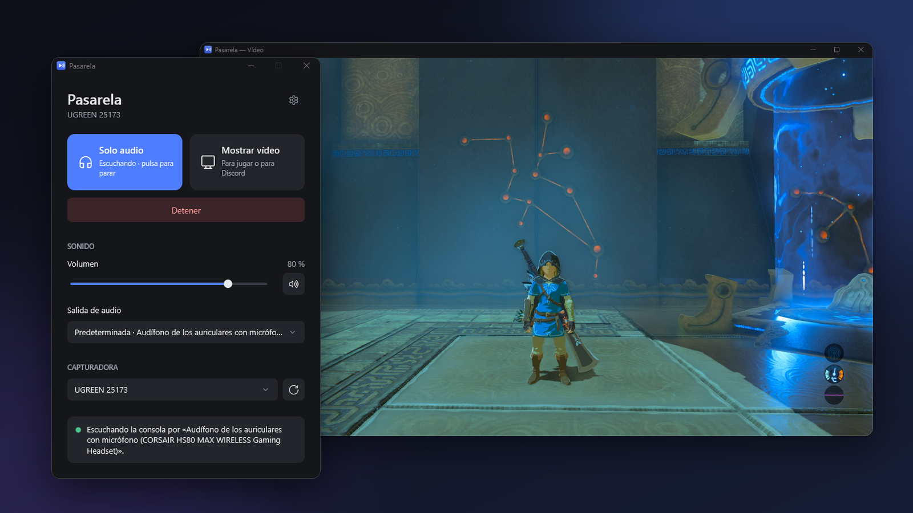
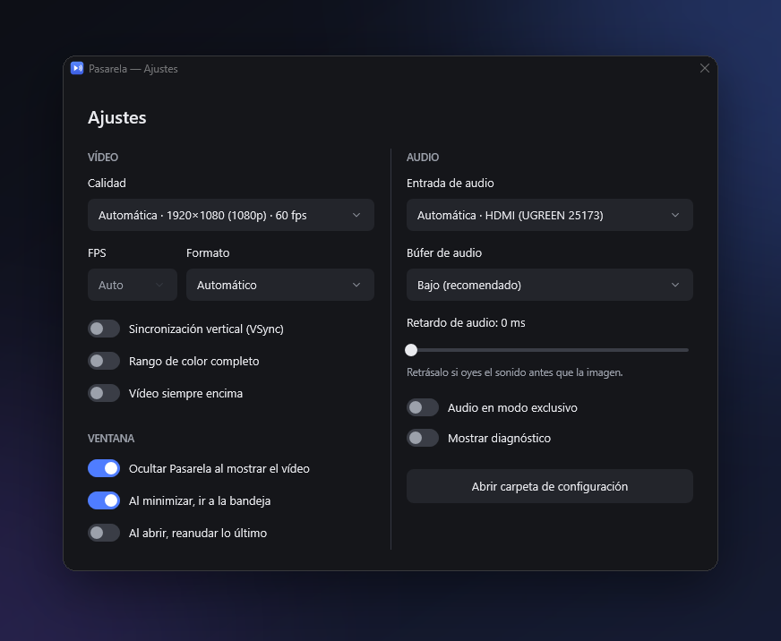

# Pasarela

<p align="center">
  
</p>

Aplicación pequeña para Windows 10/11 que sustituye a OBS cuando solo quieres **oír o ver tu consola** a través de una capturadora HDMI (Nintendo Switch 2, PS5…).

- **Solo audio:** un clic y el sonido de la consola sale por tus auriculares del PC. No abre el vídeo de la capturadora, no usa la GPU y apenas consume (medido: 0,02 % de CPU y ~10 MB de RAM privada).
- **Mostrar vídeo:** abre una ventana con la imagen de la capturadora para jugar desde el PC o compartirla por Discord. Cerrar el vídeo no corta el audio.
- **Capturas:** guarda un PNG sin pérdida con la resolución exacta de la capturadora (por ejemplo 2560×1440), sin textos ni bordes de la app. No graba vídeo.
- Recuerda la capturadora, los auriculares y los ajustes. La calidad se elige sola (la mejor nativa que tiene sentido para tu pantalla).
- Sin cuentas, sin servidores, sin telemetría, sin grabación. Un único `.exe` portátil.

## Uso

1. Conecta la capturadora (y, si quieres, el monitor por su salida HDMI *passthrough*).
2. Abre `Pasarela.exe`.
3. Pulsa **Solo audio** para oír la consola, o **Mostrar vídeo** para verla.

En la ventana de vídeo: **doble clic** = pantalla completa, **Esc** = salir de pantalla completa, **C** = hacer captura, **clic derecho** = opciones, **M** = silenciar, **T** = siempre encima, **F3** = diagnóstico.

- Al pulsar **Mostrar vídeo**, la ventana principal se oculta y solo queda la del vídeo. Al cerrar el vídeo vuelve sola (el audio sigue sonando).
- Al **minimizar** la ventana, Pasarela pasa a **segundo plano**: desaparece de la barra de tareas y sigue funcionando con un icono en la bandeja del sistema. Un clic en ese icono la devuelve; con el botón derecho tienes Solo audio, Mostrar vídeo, Silenciar, Detener y Salir.
- El engranaje abre los **Ajustes**. Ahí puedes activar que, al abrir, inicie «Solo audio»: así oír la consola es abrir el programa y minimizarlo.

<p align="center">
  
</p>

### Capturas de pantalla

Con el vídeo abierto, pulsa **C** (o clic derecho › *Hacer captura*; también está en el menú de la bandeja). Se guarda un PNG en `Imágenes\Pasarela` con la **resolución nativa de la capturadora**, sin escalar a la ventana y sin el diagnóstico ni los avisos de la app. El nombre incluye la fecha, la hora y la resolución. El botón *Abrir carpeta de capturas* de los Ajustes la abre. Pasarela no graba vídeo; para clips usa la herramienta de tu tarjeta gráfica.

### Compartir por Discord

1. Pulsa **Mostrar vídeo**.
2. En Discord, comparte la ventana **«Pasarela — Vídeo»** con el sonido activado.

Notas:
- Discord no documenta cómo captura el audio de una ventana; Windows (desde la versión 2004) permite capturar el audio de un proceso concreto, y Pasarela reproduce el sonido desde su propio proceso por el mezclador normal de Windows, que es lo que esa captura necesita. **Está pendiente de comprobar con tu Discord** (ver [docs/PRUEBAS.md](docs/PRUEBAS.md)).
- Si Discord muestra la ventana en negro, activa en Discord la opción de captura de pantalla con la tecnología más reciente (Ajustes › Voz y vídeo › Compartir pantalla). La ventana de Pasarela es una ventana normal de Direct3D 11 (nunca pantalla completa exclusiva), que es lo que esa captura admite.
- Tus amigos verán la calidad que permitan Discord y tu conexión; Pasarela solo garantiza una buena señal local.

### PS5, Switch 2 y HDCP

- **PS5:** desactiva *Ajustes › Sistema › HDMI › Activar HDCP* para poder capturar juegos. Con HDCP activado la capturadora recibe una señal protegida y la imagen sale en negro o con un aviso. Pasarela no intenta saltarse ninguna protección. Algunas apps de vídeo (Netflix, etc.) exigen HDCP y no se podrán capturar.
- **Switch 2:** en modo dock no aplica HDCP a los juegos; funciona directamente.
- La consola envía la resolución que acepta el monitor conectado al *passthrough*. Si tu monitor es 1080p, capturar en 4K no aporta nada; por eso el modo automático no supera la resolución de tu pantalla.
- HDR, VRR y 120 Hz dependen de la capturadora. Si ves cortes o colores raros, prueba en la consola a desactivar HDR o bajar a 60 Hz.

## Ajustes

| Ajuste | Para qué sirve |
| --- | --- |
| Calidad / FPS / Formato | «Automática» elige ~60 FPS, la mayor resolución que cabe en tu pantalla y formatos sin compresión (NV12/YUY2) antes que MJPEG. Solo se listan modos que la capturadora declara de verdad. |
| Entrada de audio | Automática: la entrada que pertenece a la misma capturadora (detectada por el identificador del aparato). |
| Búfer de audio | *Bajo* (recomendado), *Ultra bajo* (puede chasquear) o *Seguro*. |
| Retardo de audio | Retrasa el sonido a propósito si lo oyes antes que la imagen. Por defecto, 0. |
| Sincronización vertical | Desactivada = cada fotograma se muestra en cuanto llega (mínima latencia, puede haber *tearing*). Activada = sin *tearing*, hasta un refresco más de retardo. |
| Ocultar Pasarela al mostrar el vídeo | Activado por defecto: con vídeo solo se ve su ventana. |
| Al minimizar, ir a la bandeja | Minimizar = segundo plano. |
| Al abrir, iniciar Solo audio | Al abrir Pasarela empieza a sonar la consola sin pulsar nada. |
| Abrir carpeta de capturas | Abre `Imágenes\Pasarela`, donde se guardan las capturas. |
| Pantalla encendida en «Solo audio» | Desactivada por defecto. Hace que Windows no apague la pantalla mientras suena el audio, como ya ocurre con «Mostrar vídeo». |
| Capturadora activa en «Solo audio» | Desactivada por defecto. Abre el vídeo de la capturadora en segundo plano, sin mostrarlo ni procesarlo, con el mismo modo que usas en «Mostrar vídeo». Es un apaño para capturadoras que, sin vídeo abierto, cortan el audio de vez en cuando. Gasta algo de USB y procesador, y otros programas (OBS) no podrán usar la capturadora a la vez. |
| Diagnóstico | FPS recibidos y mostrados, fotogramas descartados, tiempos medidos, colchón de audio y cortes. |

La configuración se guarda en `Pasarela.ini` junto al `.exe` (o en `%APPDATA%\Pasarela` si esa carpeta no admite escritura). El registro `Pasarela.log` se reinicia en cada ejecución y nunca se envía a ningún sitio.

## Requisitos

- Windows 10 2004 o posterior / Windows 11, 64 bits.
- Una capturadora que Windows reconozca como cámara (UVC o con driver AVStream). Probada con **UGREEN 25173**; con otras marcas no se garantiza.
- Windows debe permitir el acceso a la cámara y al micrófono para aplicaciones de escritorio (Configuración › Privacidad y seguridad).
- La capturadora solo admite un programa de vídeo a la vez: si Pasarela no consigue el vídeo, cierra OBS u otras apps que la usen.

## Compilar

Requiere [llvm-mingw](https://github.com/mstorsjo/llvm-mingw/releases) (variante `ucrt-x86_64`) descomprimido en `tools/`.

```powershell
powershell -ExecutionPolicy Bypass -File build.ps1
```

Genera `dist/Pasarela.exe` (enlazado estáticamente, sin DLL adicionales).

## Documentación

- [docs/ARQUITECTURA.md](docs/ARQUITECTURA.md): investigación, decisiones técnicas, latencia y diseño.
- [docs/PRUEBAS.md](docs/PRUEBAS.md): qué está verificado y qué queda por comprobar con tu hardware.

## Licencia

Código bajo licencia MIT, `Copyright (c) 2026 Dreex`. Ver [LICENSE](LICENSE) y [THIRD_PARTY.md](THIRD_PARTY.md).

El autor no se hace responsable del uso del programa ni del contenido que se capture con él.

Hecho por **Dreex**.
